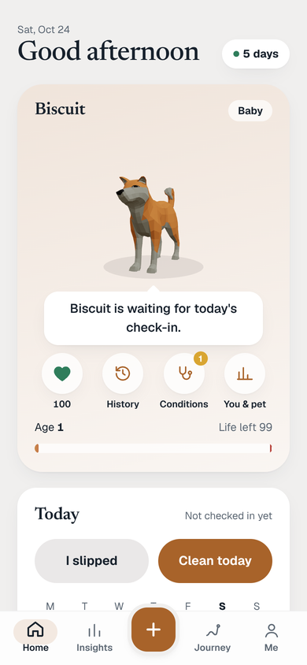

<h1 align="center">Pawse for Android</h1>

<b>Pause the habit. Keep your pet happy.</b>

Pawse helps you change a habit you want to understand or cut back on. Each habit gets its own pet. Check in each day, and the pet shows how you're doing: it's happy when you're on track and waits for you when you haven't checked in yet.

  <picture>
    <source media="(prefers-color-scheme: dark)" srcset="screenshots/home-dark.png">
    
  </picture>

## What you can do

- **Check in each day.** Mark a clean day, log a slip, or note an urge. One tap is enough.
- **Keep your pet company.** Pick one of six pets, name it, and choose its coat and personality.
- **See your history.** The calendar and History show check-ins, slips and pauses over time.
- **Get through urges.** Quick support for the moment a craving hits.
- **Track more than one habit.** Each habit has its own pet and plan. Pause a habit any time; a paused habit sends no reminders.
- **Set the look.** Light, dark or system theme, with an accent colour of your choice.
- **Keep your data safe.** Sign in to sync your pet and history to your account. Add a PIN to lock the app.

## Download

**[Download Pawse 3.7.0 (APK, 5.1 MB)](https://raw.githubusercontent.com/jithujsam/pawse-releases/main/apk/Pawse-3.7.0.apk)**

## Install

1. Open the link above on your Android phone and download the file.
2. Tap the downloaded file. If Android asks, allow installs from your browser (Settings, then "Install unknown apps").
3. Tap **Install**, then open Pawse.

**Coming from 2.1.0 or older? Do this once:**
1. Open your old Pawse, check you're signed in (Me → Account), and tap **Sync now**, so everything is saved to your account.
2. Uninstall the old Pawse. Since 3.0.0 Pawse has a new signature, so Android can't install it over the old one.
3. Install the new Pawse and sign in with the same account. Your pet and history come back. Anything that never synced to your account doesn't.

From 3.0.0 on, new versions install over the old one as usual, and the app tells you on its home screen when one is out.

## Versions

| Version | Date | What's new |
|---|---|---|
| 3.7.0 | 2026-10-26 | A warmer, more polished look: clay-toned colours, softer depth and a raised + button; dark mode takes the shade of your accent colour (deep navy for blue, aubergine for plum) instead of plain black; Insights and the health sheet refreshed; the tabs are now Home, Journey, Insights and Me |
| 3.6.0 | 2026-10-26 | Make a pet in two steps: pick it from all six, name it and choose its coat and personality, then say what it's for; the pet screen is just the pet and a daily check-in with four quick buttons (slipped, urge, goal met, not tracking); make or edit a plan from the + menu, for any pet; the calendar starts with your pet's age; a smaller check-in on Insights with the weekly review folded away |
| 3.5.0 | 2026-10-26 | Every question is a dropdown instead of tabs and chips, each with a Something else option to type your own; new common choices for habits, what to count, situations, reasons and first steps; the log sheet can pick any past day |
| 3.4.1 | 2026-10-25 | Your plan is in your own words too: reasons, hard situations and first step are typed, with no suggested chips |
| 3.4.0 | 2026-10-25 | Delete a pet from its card; a new launch screen; adding a habit and setting up are all in your own words, with nothing prefilled (name what to count, and what sets it off, yourself); new check-ins ask only for what you chose, plus a note and an optional photo; the app stays above the phone's navigation bar |
| 3.3.0 | 2026-10-25 | A calm opening and loading animation; the 3D dog has a face that shows how it feels (eyes, brows, tears, tongue, ears, tail); a separate Drawn / 3D style choice for the dog; the Pets list and profile show the 3D dog; the app notices new versions, downloads them and checks them before installing (3.2.0) |
| 3.1.0 | 2026-10-25 | Track more than one habit, each with its own pet and plan; pause and resume a track (a paused track sends no reminders); urge support that helps in the moment; the calendar shows check-ins and pauses; kinder wording after a slip; new tabs: Home, Calendar, Insights, You; accessibility and contrast fixes |
| 3.0.0 | 2026-10-25 | Set your own goal; urge support; calm screen after a slip; weekly review; days you don't record count for nothing; your companion no longer dies by default (classic rules optional); at most two reminders a day. New signature: uninstall 2.1.0 first, then sign in |
| 2.1.0 | 2026-10-24 | Light, dark or system theme with accent colours; switch species; 3D dog and fox; AI explanations fixed |

Release details and checks: [RELEASE_STATUS.md](RELEASE_STATUS.md).

SHA-256 of Pawse-3.7.0.apk: `a8b0c522afb622a22a75e800a8fb558022dd367662b0469e598152392351cbed`

## Test build (not a release)

For testers only: **[Pawse Test 3.0.0 (APK, 5.9 MB)](test-builds/Pawse-Test-3.0.0-8.apk)**. It installs as a separate app called "Pawse Test", next to Pawse, and never replaces it or its data. It isn't offered as an update, and it uses your real account, so try it with a test account. Build details: [Pawse-Test-3.0.0-8.txt](test-builds/Pawse-Test-3.0.0-8.txt).

SHA-256 of Pawse-Test-3.0.0-8.apk: `3dd30940ff7d3a37d7495fecf3d46d2a34973a50ad032c408741d04c8ade3fa5`
