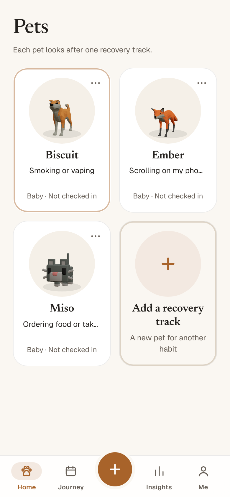
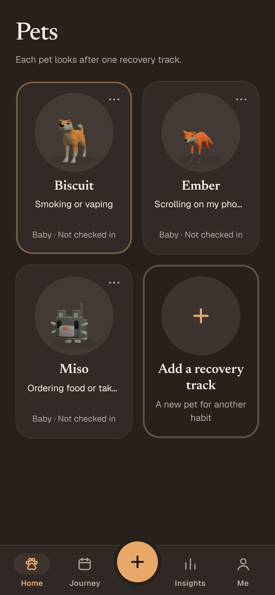
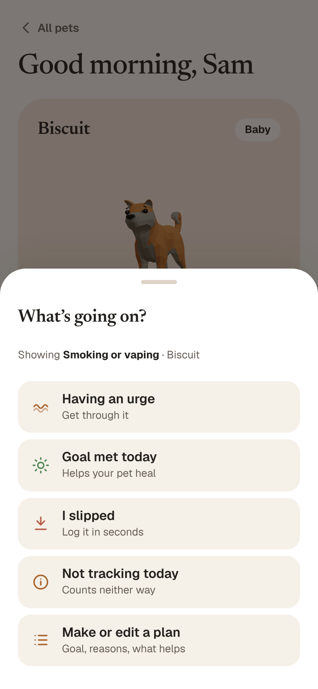
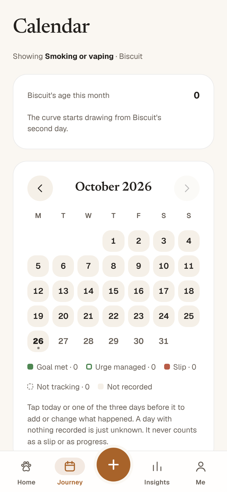
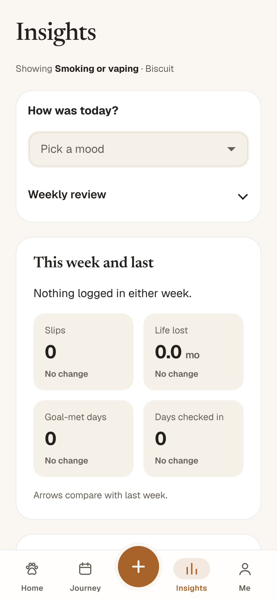
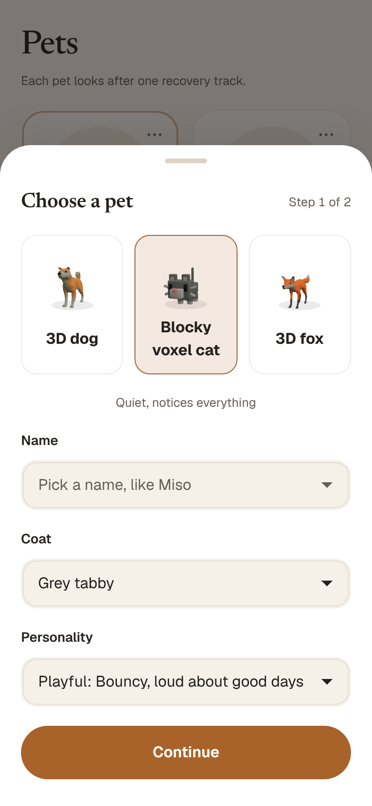
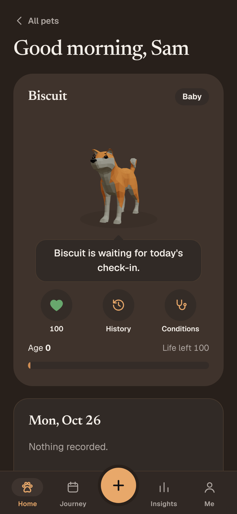

<h1 align="center">pawse</h1>
<h3 align="center">Pause the habit. Keep your pet happy.</h3>

A pet for every habit you're changing. Good days keep it healthy, slips cost a little, and it's never cruel about it.

<a href="https://raw.githubusercontent.com/jithujsam/pawse-releases/main/apk/Pawse-3.9.2.apk"><b>Download pawse 3.9.2 for Android (APK, 6.7 MB)</b></a>

  
  
  

---

## Your pet grows when you do

Pick something you want to change, such as late-night food orders, impulse buys, smoking or doomscrolling, and set your own goal: stop, cut down, or understand it first. Each habit gets a pet of its own. Check in each day and it stays bright. Slip, and it feels it, without ever being cruel about it.

- **Three 3D pets:** a 3D dog with a face that shows how it feels, a blocky voxel cat and a 3D fox. Each has its own coats and one of four personalities: playful, calm, sassy or wise.
- **Check in with a tap:** I slipped, having an urge, goal met, or not tracking today. One short menu, done in seconds.
- **Fix the last few days:** forgot yesterday? Tap any highlighted date from the last four days on the calendar to mark it, or log a slip for it.
- **Health you can read:** a heart from 0 to 100, the pet's life story, and conditions that say how many good days heal them.
- **Fair rules:** a slip costs a few months of the pet's life, a good day heals some back, and you always see the way back. A day you don't record is unknown, never a failure.

  
  
  

## Help when it matters

- **Urge support:** pause and notice, name it, change where you are, breathe, or do something else, with your pet beside you.
- **After a slip:** calm words, what you've built still stands, and one small thing to try next time.
- **Your plan, in your words:** your goal, your reasons, your hard moments and your first step. pawse shows them back to you when an urge hits.
- **Weekly review and insights:** this week against last, urges managed, your risky hours and one change for next week.
- **Three tones:** Gentle, Honest or Direct. You choose how your pet talks to you.

## On your home screen

Two pet widgets stack every pet you're caring for, each one breathing in its mood today. Pick the one on a card, or the clear one that sits on your wallpaper. Tap a pet to check in.

## Made for you

- **Several habits at once,** each with its own pet and plan. Pause any of them whenever you need to.
- **Yours to style:** light, dark or system theme, and your own accent colour. The paw follows it.
- **Your records, protected.** They back up to your own account, which only you can sign in to. Set a PIN and everything on the phone is encrypted. When you log a slip, its details go to an AI model that writes a short note back. No calorie, weight or restriction tracking, ever.

  
  

## Install in a minute

1. Tap the download button above on your Android phone.
2. Open the file. If Android asks, allow installs from your browser (Settings, then "Install unknown apps").
3. Tap **Install**, then open pawse.

pawse checks for updates itself. When a new version is out, it tells you when you open it, and one tap downloads it and opens Android's installer.

**Coming from 2.1.0 or older? Do this once:**
1. Open your old app, check you're signed in (Me → Account), and tap **Sync now**, so everything is saved to your account.
2. Uninstall the old app. Since 3.0.0 it has a new signature, so Android can't install it over the old one.
3. Install the new pawse and sign in with the same account. Your pet and history come back. Anything that never synced to your account doesn't.

From 3.0.0 on, new versions install over the old one as usual.

---

| Version | Date | What's new |
|---|---|---|
| 3.9.2 | 2026-10-26 | The calendar and the slip sheet show real dates for the last four days, so you can fix a day you forgot. Tapping a highlighted date opens the same day sheet as before |
| 3.9.1 | 2026-10-26 | Screens, onboarding steps and the calendar month fade in and out, with no sliding from the side. Sections fade in without moving. The update pop-up is clearer, with room between its buttons |
| 3.9.0 | 2026-10-26 | A clearer update pop-up, with room between its buttons. Tab screens show placeholders while they load, with no held loader. Calendar: today and the two days before it open in a sheet to log a slip or a clean day. Dropdowns use pawse's own menu |
| 3.8.9 | 2026-10-26 | Calendar: today and the two days before it open in a sheet to log a slip or mark a clean day. Loading plays once, then the page appears. Dropdowns use pawse's own menu instead of the phone's picker |
| 3.8.8 | 2026-10-26 | The update pop-up is cleaner: no icon, roomier spacing, and Later and Don't remind sit under Download & install |
| 3.8.7 | 2026-10-26 | Safer, clearer words everywhere. Food, weight and crisis language is caught in every field you can type in, and pawse never tracks calories or weight. Privacy and reminder text now matches what the app really does, your pet never refuses food or makes you earn its care, counts read correctly (1 month, 1 slip), and the account screens say what to do next. The tabs are Home, Journey, Insights and Me |
| 3.8.6 | 2026-10-26 | Every pet is 3D: a 3D dog, a blocky voxel cat and a 3D fox. Fill in or correct today and the three days before it from the calendar. A compact check-in menu, a plain dim behind sheets (no more smeared text), a paw that fills toe by toe while loading, and widgets that show each pet in 3D in its mood today. The name is now pawse |
| 3.8.5 | 2026-10-26 | The update pop-up is back, so new versions are always shown when you open pawse. Pop-ups blur the page behind them. Pet widgets are included |
| 3.8.4 | 2026-10-26 | The page behind sheets and pop-ups is properly blurred, so it stays out of the way; the pet widgets and cleaner look from 3.8.3 are included |
| 3.8.3 | 2026-10-26 | Pet widgets: a stack of your pets on your home screen, in a solid or a clear version, each one moving and reacting to its mood. The look is cleaner and roomier, with the glow gone. The update popup is gone; the Home banner still shows new versions |
| 3.8.2 | 2026-10-26 | The glowing effects are gone across the app, and cards, buttons, lists and sheets have more room to breathe |
| 3.8.1 | 2026-10-26 | The paw is now the logo everywhere: on the launch screen, the loading screen and the app icon, which now sits on a cream background; the loading screen is just the paw, beating softly |
| 3.8.0 | 2026-10-26 | An update popup when you open pawse, in the app's own style: what's new, then Download & install, Later (asks again tomorrow) or Don't remind (skips that version); the background update notification is gone; if the update check can't reach the internet it now says so instead of "you have the latest version" |
| 3.7.0 | 2026-10-26 | A warmer, more polished look: clay-toned colours, softer depth and a raised + button; dark mode takes the shade of your accent colour (deep navy for blue, aubergine for plum) instead of plain black; Insights and the health sheet refreshed; the tabs are now Home, Journey, Insights and Me |
| 3.6.0 | 2026-10-26 | Make a pet in two steps: pick it from all six, name it and choose its coat and personality, then say what it's for; the pet screen is just the pet and a daily check-in with four quick buttons (slipped, urge, goal met, not tracking); make or edit a plan from the + menu, for any pet; the calendar starts with your pet's age; a smaller check-in on Insights with the weekly review folded away |
| 3.5.0 | 2026-10-26 | Every question is a dropdown instead of tabs and chips, each with a Something else option to type your own; new common choices for habits, what to count, situations, reasons and first steps; the log sheet can pick any past day |
| 3.4.1 | 2026-10-25 | Your plan is in your own words too: reasons, hard situations and first step are typed, with no suggested chips |
| 3.4.0 | 2026-10-25 | Delete a pet from its card; a new launch screen; adding a habit and setting up are all in your own words, with nothing prefilled (name what to count, and what sets it off, yourself); new check-ins ask only for what you chose, plus a note and an optional photo; the app stays above the phone's navigation bar |
| 3.3.0 | 2026-10-25 | A calm opening and loading animation; the 3D dog has a face that shows how it feels (eyes, brows, tears, tongue, ears, tail); a separate Drawn / 3D style choice for the dog; the Pets list and profile show the 3D dog; the app notices new versions, downloads them and checks them before installing (3.2.0) |
| 3.1.0 | 2026-10-25 | Track more than one habit, each with its own pet and plan; pause and resume a track (a paused track sends no reminders); urge support that helps in the moment; the calendar shows check-ins and pauses; kinder wording after a slip; new tabs: Home, Calendar, Insights, You; accessibility and contrast fixes |
| 3.0.0 | 2026-10-25 | Set your own goal; urge support; calm screen after a slip; weekly review; days you don't record count for nothing; your companion no longer dies by default (classic rules optional); at most two reminders a day. New signature: uninstall 2.1.0 first, then sign in |
| 2.1.0 | 2026-10-24 | Light, dark or system theme with accent colours; switch species; 3D dog and fox; AI explanations fixed |

Release details and checks: [RELEASE_STATUS.md](RELEASE_STATUS.md).

**SHA-256 of Pawse-3.9.2.apk:** `971cbdc2dec69f6cfee5c28a04a407a9b71cb0fa89e486a9d7fd8c8c006674ca`

## Test build (not a release)

For testers only: **[Pawse Test 3.0.0 (APK, 5.9 MB)](test-builds/Pawse-Test-3.0.0-8.apk)**. It installs as a separate app called "Pawse Test", next to pawse, and never replaces it or its data. It isn't offered as an update, and it uses your real account, so try it with a test account. Build details: [Pawse-Test-3.0.0-8.txt](test-builds/Pawse-Test-3.0.0-8.txt).

SHA-256 of Pawse-Test-3.0.0-8.apk: `3dd30940ff7d3a37d7495fecf3d46d2a34973a50ad032c408741d04c8ade3fa5`
